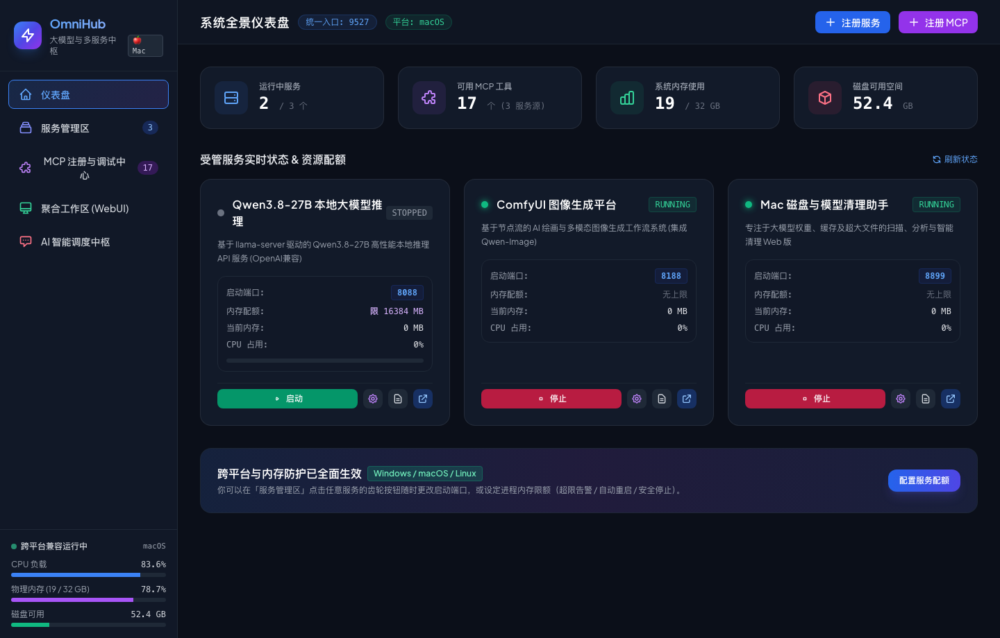
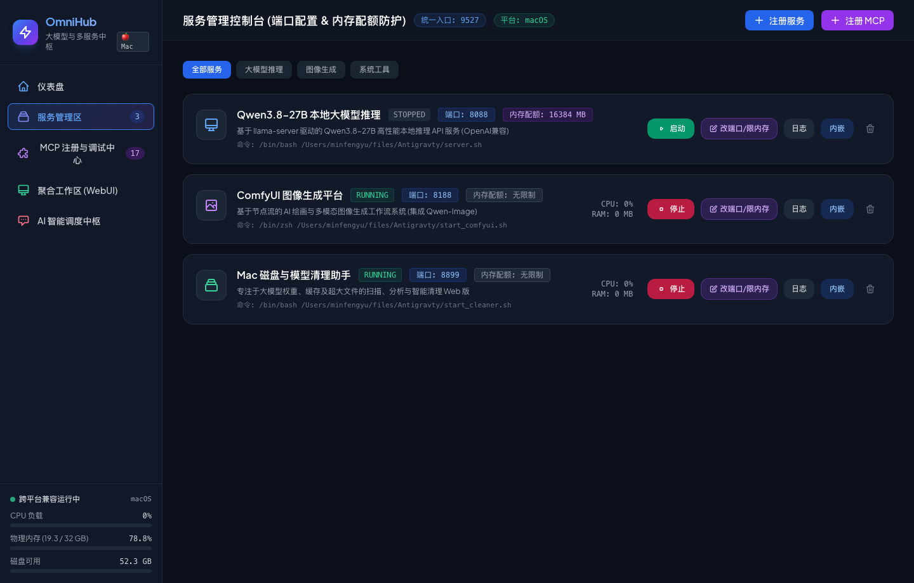
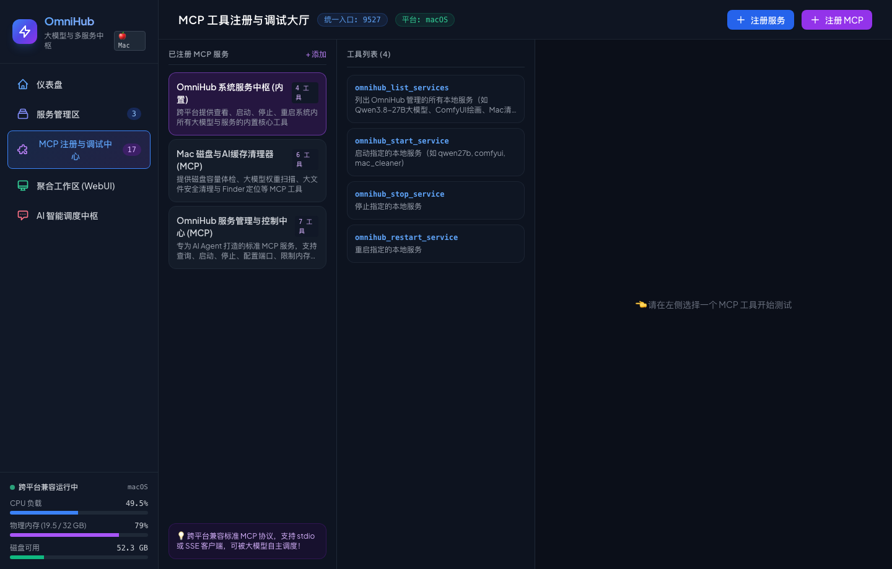
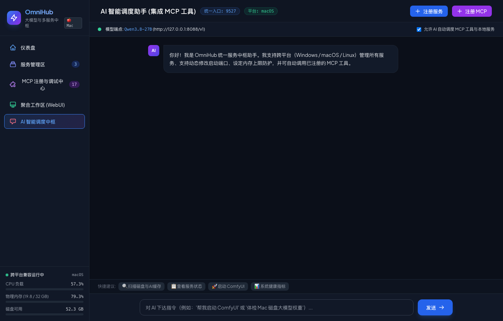

# 🌟 OmniHub - Unified AI & Service Gateway Platform
### 大模型与多服务统一中枢平台

<p align="center">
  
  
  
  
</p>

---

[English](#english-documentation) | [中文说明](#中文文档)

---

<a name="中文文档"></a>
## 🇨🇳 中文文档

### 📖 项目简介
**OmniHub** 是一款专为本地大模型、绘图引擎及各类后台工具打造的**一体化统一集成控制台与网关中枢**。

日常本地跑 AI 服务时，常常面临多个痛点：
- 服务过多，端口分散（如 8088、8188、8899 等），每次都要翻终端窗口、找启动脚本；
- 浏览器打开了十几个 Tab 标签页，在 ComfyUI、大模型问答、系统工具间来回切；
- 本地大模型吃满显存与内存引发整机死机；
- 本地智能体（AI Agent）缺少统一的管理接口，无法自主操控后台服务。

**OmniHub** 将所有服务汇聚在单个现代化 WebUI 界面中（默认端口 `9527`），并内置了专属 **MCP Server**，让任何 AI Agent 都能通过标准 MCP 协议对所有服务区进行全自动操控！

---

### 📸 真实运行截图

#### 1. 系统全景仪表盘 (System Overview & Services)
直观展示宿主机硬件负载（CPU、物理内存、磁盘空间）、运行中服务总览与 MCP 工具状态。


#### 2. 服务管理区：自定义端口修改 & 内存配额防护
支持对每个服务一键启动/停止/重启，查看实时控制台日志。支持随时修改监听端口并设定内存上限配额（超限告警 / 自动重启降载 / 安全终止保护）。


#### 3. MCP 注册与交互式调试大厅 (MCP Hub & Playground)
自动发现并解析任何 MCP Server 的工具与其 JSON Schema，动态生成参数表单，支持在线填参测试与调用执行。


#### 4. AI 智能调度助手 (Autonomous AI Agent with MCP)
连接本地大模型（默认 Qwen3.8-27B），通过 Function Calling 自动识别意图并调度后台服务或执行 MCP 工具任务。


---

### ✨ 核心特性

1. **统一单入口 WebUI (`http://127.0.0.1:9527`)**
   - 告别端口记忆负担，单入口整合大模型推理、ComfyUI 绘画、系统清理工具与终端日志。
   - 现代深色暗黑科技感 UI，原生适配高分辨率屏幕与流式渲染。

2. **多服务生命周期管理 & 跨平台进程守护**
   - 预置管理：Qwen3.8-27B 本地推理 (`llama-server`)、ComfyUI 图像平台、Mac 磁盘与模型清理助手。
   - 支持自由扩展：点击界面「+ 注册服务」随时添加任意命令、脚本或 Docker 服务。
   - 实时日志查看器：基于 WebSocket 实时推流，免切换终端即可查看控制台输出。

3. **动态端口修改与自动参数注入**
   - 在 Web 界面直接为任意服务修改启动端口（如将 8088 修改为 8090）。
   - 自动在启动时注入端口参数，工作区内嵌 URL 自动同步。

4. **进程树内存占用限制 (OOM 防护)**
   - 跨平台递归监控整个进程树物理内存（RSS）。
   - 支持预设上限（2GB / 4GB / 8GB / 16GB / 自定义，0 为不限）。
   - 三级防护：⚠️ **仅告警 (alert)** | 🔄 **自动重启释放内存 (restart)** | 🛑 **安全终止防死机 (stop)**。

5. **OmniHub 专属 MCP Server (`omnihub-service-manager`)**
   - 本地 AI Agent（Antigravity, Claude Desktop, Cursor, Cline）可通过标准 MCP 协议直接操作该服务：
     - `list_all_services()`: 查看所有服务状态、端口与内存指标
     - `start_service(service_id, custom_port)`: 启动指定服务
     - `stop_service(service_id)`: 安全停止服务
     - `restart_service(service_id)`: 重启服务
     - `configure_service_port_and_memory(...)`: 修改端口与内存配额
     - `get_service_logs(service_id, limit)`: 调取最近日志供 Agent 排查
     - `get_system_health_metrics()`: 获取系统 CPU/内存/磁盘健康指标

6. **REA (Reverse Engineer Anything) 深度逆向工程控制台 & 170+ MCP 工具**
   - 原生集成 REA v6.4.0 逆向分析引擎，提供专属 Web 控制台 (`http://127.0.0.1:8877`) 与一键分析面板。
   - 包含 170+ MCP 原生逆向工具：覆盖 Android APK、iOS/macOS Mach-O、Windows PE/.NET、Electron/JavaScript、函数伪代码反编译与动态调用追踪。
   - 内置智能上下文工具路由（Smart Tool Routing），在本地大模型（如 Qwen3.8-27B 8K 上下文）中根据用户意图毫秒级语义检索匹配工具，兼顾超大工具库与超快推理响应。

7. **全平台无缝兼容 (Windows, macOS, Linux)**
   - 跨平台进程树管理机制，完全抹平系统底层进程信号与控制台差异。
   - 提供 `start.sh` (Mac/Linux)、`start.bat` (Windows) 及通用的 `python start.py`。

---

### 🚀 快速开始

#### 依赖环境
- Python 3.10+
- 推荐已安装: `pip`

#### 1. 启动服务

**macOS / Linux 用户：**
```bash
./start.sh
```

**Windows 用户：**
直接双击 `start.bat` 或在终端运行：
```cmd
start.bat
```

**跨平台通用 Python 启动（所有系统）：**
```bash
python start.py
```

启动脚本会自动检查并补齐缺失的依赖，并在默认浏览器中自动打开统一控制台：
👉 **http://127.0.0.1:9527**

---

### 🧩 本地 Agent 接入配置 (MCP)

在你的 Claude Desktop / Cursor / Antigravity 的配置文件（如 `claude_desktop_config.json` 或 `mcp_config.json`）中添加：

```json
{
  "mcpServers": {
    "omnihub-service-manager": {
      "command": "python3",
      "args": [
        "/path/to/omnihub_mcp_server.py"
      ]
    }
  }
}
```

---
---

<a name="english-documentation"></a>
## 🇬🇧 English Documentation

### 📖 Introduction
**OmniHub** is an all-in-one unified dashboard, service gateway, and Model Context Protocol (MCP) hub designed for local AI models, generative image workflows, and developer tools.

When running multiple AI services locally, developers often face fragmented experiences:
- Too many ports (8088, 8188, 8899, etc.) and scattered terminal windows;
- Switching back and forth across dozens of browser tabs;
- Large models consuming all system memory and causing system freezes;
- Local AI Agents lacking an integrated interface to manipulate background services.

**OmniHub** unifies everything into a single modern WebUI (default port `9527`) and exposes a dedicated **MCP Server**, empowering any local AI Agent to orchestrate and manage all services programmatically.

---

### 📸 Screenshots

| View | Preview |
| :--- | :--- |
| **System Dashboard** |  |
| **Service & Quota Manager** |  |
| **MCP Playground** |  |
| **Autonomous AI Hub** |  |

---

### ✨ Features

1. **Unified WebUI Entry (`http://127.0.0.1:9527`)**
   - Single port to rule them all: LLM inference, ComfyUI, system cleaner, and terminal logs.
   - Built with Vue 3, TailwindCSS, and JetBrains Mono fonts.

2. **Service Lifecycle & Cross-Platform Process Guardian**
   - Manage services with 1-click: Start, Stop, Restart, and stream live terminal logs via WebSocket.
   - Expand easily: Register any custom script, shell command, or background daemon.

3. **Dynamic Port Configuration**
   - Modify any service's listening port directly from the UI without modifying bash scripts.
   - Ports are automatically injected on startup, and workspace iframe URLs sync in real time.

4. **Process-Tree Memory Limit & OOM Protection**
   - Recursively monitors the RSS memory of the entire process tree.
   - Custom limits (2GB, 4GB, 8GB, 16GB, or unlimited).
   - 3 protection modes: **Alert only** | **Auto-restart to release memory** | **Safe stop**.

5. **Dedicated MCP Server (`omnihub-service-manager`)**
   - Exposes standard Model Context Protocol tools for agents (Claude Desktop, Antigravity, Cursor, Cline):
     - `list_all_services`: Inspect all service states, metrics, and memory quotas.
     - `start_service`: Launch services with optional port override.
     - `stop_service`: Terminate processes cleanly and release ports.
     - `restart_service`: Quick reboot of services.
     - `configure_service_port_and_memory`: Dynamically tune ports & memory limits.
     - `get_service_logs`: Fetch console outputs for agent-driven debugging.
     - `get_system_health_metrics`: Query CPU, memory, and disk health metrics.

6. **REA (Reverse Engineer Anything) Suite & 170+ MCP Tools**
   - Integrated REA v6.4.0 reverse-engineering engine with dedicated Web Workbench (`http://127.0.0.1:8877`).
   - Supports Android APKs, Apple Mach-O binaries, Windows PE/.NET, Electron/JavaScript applications, and pseudo-code decompilation.
   - Intelligent tool semantic routing keeps context sizes compact (~2k tokens) to fit safely within local LLM 8K context windows.

7. **Cross-Platform Compatibility (Windows, macOS, Linux)**
   - Gracefully manages process trees across Win32 and POSIX environments.
   - Launchers provided: `start.sh`, `start.bat`, and `python start.py`.

---

### 🚀 Getting Started

```bash
# macOS / Linux
./start.sh

# Windows
start.bat

# Universal Python (All Platforms)
python start.py
```

Then visit: 👉 **http://127.0.0.1:9527**

---

### 📄 License
This project is licensed under the [MIT License](LICENSE).
